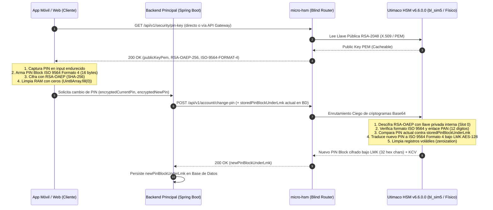

# Micro-HSM: Cambio de PIN Seguro E2E (PCI-PIN) con Utimaco Payment HSM

Microservicio en **Java 21 + Spring Boot 3.3.5** que implementa el flujo de **Enrutamiento Ciego (Blind Routing)** extremo a extremo (E2E) para el cambio de PIN transaccional de 4 dígitos bajo el estándar **ISO 9564 Formato 4** y cifrado asimétrico **RSA-OAEP (SHA-256)** con **Utimaco SecurityServer / PaymentServer HSM v6.6.0.0**.

---

## 1. Arquitectura del Flujo E2E (Blind Routing)



---

## 2. Especificación Detallada de Endpoints (API Reference)

### 2.1. Obtener Llave Pública RSA del HSM
Expone la llave pública RSA-2048 activa del HSM para que el Frontend (Web/App) cifre los bloques de PIN. Cuenta con soporte de caché en servidor (`@Cacheable("hsmPinPublicKey")`) y cabeceras HTTP `Cache-Control: max-age=900, public`.

- **Método y Ruta:** `GET /api/v1/security/pin-key`
- **Respuesta Exitosa (`200 OK`):**
```json
{
  "keyId": "utimaco-pin-rsa-2048-v1",
  "algorithm": "RSA-OAEP-256",
  "pinBlockFormat": "ISO-9564-FORMAT-4",
  "publicKeyPem": "-----BEGIN PUBLIC KEY-----\nMIIBIjANBgkqhkiG9w0BAQEFAAOCAQ8AMIIBCgKCAQEAmRtd...\n-----END PUBLIC KEY-----",
  "publicKeyBase64": "MIIBIjANBgkqhkiG9w0BAQEFAAOCAQ8AMIIBCgKCAQEAmRtd...",
  "issuedAt": "2026-10-29T15:47:35.094389Z"
}
```

---

### 2.2. Procesar Cambio de PIN Transaccional (Blind Routing)
Recibe los bloques de PIN actual y nuevo cifrados con la llave pública RSA del HSM (en Base64), valida el PIN actual dentro del HSM y retorna el nuevo PIN Block cifrado bajo la llave maestra local (`LMK AES-128`) en formato **ISO 9564 Formato 4** para que el backend principal lo actualice en la base de datos.

- **Método y Ruta:** `POST /api/v1/account/change-pin`
- **Headers:** `Content-Type: application/json`
- **Body de Solicitud (`ChangePinRequest`):**
```json
{
  "userId": "usr-9876543210987",
  "panOrAccountNumber": "4539123456789012",
  "encryptedCurrentPin": "PNgiuyEJ8OHJ1o9OElbaArNWFWGoP/soAsAHisiAa7iTgEVXuVTM2lS...",
  "encryptedNewPin": "lt8siVwMAXrdwC1fJi5aXJIvfVreQQVL7Ge967choEE8n+2Y34o/zuE...",
  "storedPinBlockUnderLmk": "8F4A2C91E0B37D651209AB45CDEF8901"
}
```

#### Detalle de Campos del Request:
| Campo | Tipo | Obligatorio | Descripción |
| :--- | :--- | :---: | :--- |
| `userId` | `string` | **Sí** | Identificador único del usuario en la plataforma. |
| `panOrAccountNumber` | `string` | Recomendado | Número de tarjeta (PAN de 12 a 19 dígitos) o número de cuenta numérico. Si se omite, se extraen los dígitos de `userId`. **Nota:** Ambos (App y Backend) deben usar el mismo valor para derivar los 12 dígitos ISO. |
| `encryptedCurrentPin` | `string` (Base64) | **Sí** | Criptograma RSA-OAEP (SHA-256) codificado en Base64 que contiene el PIN Block ISO 9564 Formato 4 del **PIN actual**. |
| `encryptedNewPin` | `string` (Base64) | **Sí** | Criptograma RSA-OAEP (SHA-256) codificado en Base64 que contiene el PIN Block ISO 9564 Formato 4 del **nuevo PIN**. |
| `storedPinBlockUnderLmk` | `string` (Hex 32) | Opcional en Simulador / **Sí en Prod** | El PIN Block actual del usuario que tu backend principal tiene almacenado en Base de Datos (32 caracteres hexadecimales cifrados bajo la llave `LMK_PIN_AES_128`). En modo simulador, si se envía `null` la primera vez, el simulador asume que el PIN inicial de prueba de esa cuenta es `"1234"`. |

- **Respuesta Exitosa (`200 OK` - `ChangePinResponse`):**
```json
{
  "transactionId": "9570093b-0d98-4939-bed9-3bd0ec1abac1",
  "userId": "usr-9876543210987",
  "status": "PIN_CHANGED_SUCCESSFULLY",
  "pinBlockFormat": "ISO-9564-FORMAT-4",
  "newPinBlockUnderLmk": "3A7F91C4E208B5D16904FA23C81B7E50",
  "keyCheckValue": "6226E3",
  "processedAt": "2026-10-29T16:01:59.820Z"
}
```
> **Acción en tu Backend Principal:** Al recibir `200 OK`, tu backend principal debe guardar el valor de `newPinBlockUnderLmk` en la base de datos del usuario (reemplazando el `storedPinBlockUnderLmk` anterior).

---

### 2.3. Catálogo de Errores Estandarizados (`ApiErrorResponse`)
Cualquier rechazo criptográfico o de negocio en el HSM retorna una estructura JSON uniforme:
```json
{
  "errorCode": "HSM_ERR_01",
  "message": "El PIN actual ingresado es incorrecto.",
  "httpStatus": 422,
  "path": "/api/v1/account/change-pin",
  "timestamp": "2026-10-29T16:01:59.766Z",
  "details": {}
}
```

| Código (`errorCode`) | HTTP Status | Causa y Acción Recomendada en App/Web |
| :--- | :---: | :--- |
| `VALIDATION_ERROR` | `400 Bad Request` | Faltan campos obligatorios en el JSON o `panOrAccountNumber` no tiene entre 12 y 19 dígitos. |
| `HSM_ERR_01` | `422 Unprocessable Entity` | **PIN actual incorrecto:** El PIN actual ingresado por el usuario no coincide con el almacenado bajo la LMK. Mostrar error al usuario e incrementar contador de intentos. |
| `HSM_ERR_02` | `400 Bad Request` | **Formato de PIN Block inválido:** El bloque descifrado no tiene 16 bytes o no cumple la estructura `44 + PIN + AAAAAAAAAA` de ISO 9564 Formato 4. |
| `HSM_ERR_03` | `400 Bad Request` | **PAN/Account Binding Mismatch:** Los 12 dígitos de cuenta embebidos por el Frontend dentro del PIN Block no coinciden con los de la cuenta enviada en el request. |
| `HSM_ERR_04` | `400 Bad Request` | **Fallo de descifrado RSA-OAEP:** El criptograma fue cifrado con una llave pública distinta/expirada o con parámetros OAEP diferentes a `SHA-256` + `MGF1(SHA-256)`. Refrescar `GET /api/v1/security/pin-key`. |
| `HSM_ERR_05` | `422 Unprocessable Entity` | **Nuevo PIN igual al actual:** El usuario ingresó el mismo PIN que ya tenía. |
| `HSM_ERR_06` | `422 Unprocessable Entity` | **PIN débil rechazado:** El nuevo PIN es una secuencia trivial prohibida (`0000`, `1111`..`9999`, `1234`, `4321`). |
| `HSM_ERR_98` | `502 Bad Gateway` | Error de sesión/red contra el HSM Utimaco. |

---

## 3. Guía de Implementación para el Frontend en Flutter (iOS / Android / Web)

En la carpeta `frontend-sdk/` incluimos la implementación lista para copiar en tu app Flutter:
- **Flutter / Dart (Principal):** [`frontend-sdk/pin_crypto_client.dart`](file:///Users/SebastianAbal/Documents/micro-hsm/frontend-sdk/pin_crypto_client.dart)
- **Web / TypeScript (Alternativo):** [`frontend-sdk/pin-crypto-client.ts`](file:///Users/SebastianAbal/Documents/micro-hsm/frontend-sdk/pin-crypto-client.ts)

> **Detalle Crítico en Flutter con `pointycastle`:**
> Por defecto, el `OAEPEncoding` básico de algunas librerías en Dart usa **SHA-1** internamente para la función de máscara `MGF1`, lo cual haría que el HSM Utimaco rechace el criptograma con `HSM_ERR_04` (ya que `RSA-OAEP-256` en el HSM exige **SHA-256 tanto en el Hash principal como en `MGF1`**).
> La clase [`PinCryptoFlutterClient`](file:///Users/SebastianAbal/Documents/micro-hsm/frontend-sdk/pin_crypto_client.dart#L30-L263) implementa explícitamente `RSAES-OAEP-ENCRYPT` (RFC 8017) con **SHA-256 + MGF1(SHA-256)** para garantizar compatibilidad 100% con el Utimaco Payment HSM.

### Dependencias en `pubspec.yaml` de tu App Flutter
```yaml
dependencies:
  pointycastle: ^3.9.1
  asn1lib: ^1.5.3
```

### Paso 1: Regla de Derivación de los 12 Dígitos de Cuenta (ISO 9564)
Tanto la app Flutter como el HSM vinculan el PIN Block a **12 dígitos numéricos** extraídos del PAN (número de tarjeta) o del número de cuenta (`PinCryptoFlutterClient.extractIso12AccountDigits`):
1. Eliminar cualquier carácter no numérico (`\D`).
2. **Si tiene 13 o más dígitos** (ej. un PAN de 16 dígitos como `4539123456789012`): se toman los **12 dígitos más a la derecha excluyendo el último dígito verificador** (`check digit`).
   - Ejemplo: de `4539123456789012`:
     - Se ignora el último dígito (`2`).
     - Se toman los 12 anteriores: **`912345678901`**.
3. **Si tiene 12 dígitos o menos**: se rellena con ceros (`0`) a la izquierda hasta completar 12 dígitos.

### Paso 2: Construcción Exacta del PIN Block (ISO 9564 Formato 4 - 16 bytes)
Antes de cifrar con RSA-OAEP, [`PinCryptoFlutterClient.buildIso9564Format4PinBlockBytes`](file:///Users/SebastianAbal/Documents/micro-hsm/frontend-sdk/pin_crypto_client.dart#L42-L82) construye un `Uint8List(16)` (equivalente a 32 caracteres hexadecimales) con la siguiente estructura:

```text
+-------------------+-------------------+------------------------+-------------------+------------------------+
| Nibble 0..1 (1B)  | Nibble 2..5 (2B)  | Nibble 6..15 (5B)      | Nibble 16..19 (2B)| Nibble 20..31 (6B)     |
+-------------------+-------------------+------------------------+-------------------+------------------------+
|       "44"        |   PIN (4 dígitos) |     "AAAAAAAAAA"       |      "0000"       | Cuenta ISO (12 dígitos)|
|Control=4, Long.=4 |   Ej. "7392"      | Padding fijo ISO Fmt 4 |   Prefijo PAN     |  Ej. "912345678901"    |
+-------------------+-------------------+------------------------+-------------------+------------------------+
```
- **Ejemplo completo en Hex (32 nibbles = 16 bytes binarios):**
  Para el PIN `7392` y el PAN `4539123456789012` (cuenta ISO `912345678901`):
  `447392AAAAAAAAAA0000912345678901` $\rightarrow$ `[0x44, 0x73, 0x92, 0xAA, 0xAA, 0xAA, 0xAA, 0xAA, 0x00, 0x00, 0x91, 0x23, 0x45, 0x67, 0x89, 0x01]`.

### Paso 3: Ejemplo Completo de Uso en tu App Flutter
```dart
import 'dart:convert';
import 'dart:typed_data';
import 'package:http/http.dart' as http;
import 'pin_crypto_client.dart';

Future<void> submitPinChange({
  required String userId,
  required String panOrAccountNumber,
  required Uint8List currentPinDigits, // Ej. Uint8List.fromList([1, 2, 3, 4])
  required Uint8List newPinDigits,     // Ej. Uint8List.fromList([7, 3, 9, 2])
}) async {
  // 1. Obtener la llave pública RSA-2048 del HSM (cacheable en cliente por 15 min)
  final keyResponse = await http.get(
    Uri.parse('https://tu-api.com/api/v1/security/pin-key'),
  );
  final Map<String, dynamic> keyData = jsonDecode(keyResponse.body);
  final String publicKeyPem = keyData['publicKeyPem'] as String;

  // 2. Generar el payload cifrado con RSA-OAEP (SHA-256 + MGF1-SHA-256).
  // Internamente sobrescribe con ceros (fillRange(0, len, 0)) tanto currentPinDigits,
  // newPinDigits como los bloques ISO 9564 intermedios dentro de un bloque finally.
  final Map<String, dynamic> requestBody =
      PinCryptoFlutterClient.prepareChangePinRequestPayload(
    userId: userId,
    panOrAccountNumber: panOrAccountNumber,
    currentPinDigits: currentPinDigits,
    newPinDigits: newPinDigits,
    publicKeyPem: publicKeyPem,
  );

  // 3. Enviar el payload enrutado ciegamente hacia tu Backend / micro-hsm
  final changeResponse = await http.post(
    Uri.parse('https://tu-api.com/api/v1/account/change-pin'),
    headers: {'Content-Type': 'application/json'},
    body: jsonEncode(requestBody),
  );

  if (changeResponse.statusCode != 200) {
    final error = jsonDecode(changeResponse.body);
    throw Exception('${error['errorCode']}: ${error['message']}');
  }
}
```

### Paso 4: Checklist de Seguridad en Captura y Volatilidad en Flutter (PCI-PIN)
1. **Usar el Widget [`SecurePinTextField`](file:///Users/SebastianAbal/Documents/micro-hsm/frontend-sdk/pin_crypto_client.dart#L273-L322) o un Teclado Numérico Custom en Flutter:**
   - Configura `enableInteractiveSelection: false`, `enableSuggestions: false`, `autocorrect: false`, `enableIMEPersonalizedLearning: false`, `autofillHints: const []` y `contextMenuBuilder: (_, __) => const SizedBox.shrink()`.
   - *(Recomendado en Banca Móvil)*: Si usas un teclado numérico propio dibujado en Flutter (botones `0-9`), cada pulsación debe escribir directamente el entero `0..9` en un `Uint8List(4)` pre-alocado y **nunca en un `String` de Dart** (ya que los `String` en la VM de Dart son inmutables y no pueden sobrescribirse hasta que pase el Garbage Collector).
2. **Bloquear Teclados de Terceros en iOS (`AppDelegate.swift`):**
   ```swift
   override func application(
     _ application: UIApplication,
     shouldAllowExtensionPointIdentifier extensionPointIdentifier: UIApplication.ExtensionPointIdentifier
   ) -> Bool {
     if extensionPointIdentifier == .keyboard {
       return false // Bloquea teclados de terceros (PCI-PIN)
     }
     return true
   }
   ```
3. **Bloquear Capturas de Pantalla y Grabación en Android (`MainActivity.kt`):**
   ```kotlin
   import android.os.Bundle
   import android.view.WindowManager
   import io.flutter.embedding.android.FlutterActivity

   class MainActivity: FlutterActivity() {
       override fun onCreate(savedInstanceState: Bundle?) {
           super.onCreate(savedInstanceState)
           window.setFlags(
               WindowManager.LayoutParams.FLAG_SECURE,
               WindowManager.LayoutParams.FLAG_SECURE
           )
       }
   }
   ```
4. **Limpieza Inmediata de Memoria (`zeroize`):**
   - [`PinCryptoFlutterClient.zeroize(buffer)`](file:///Users/SebastianAbal/Documents/micro-hsm/frontend-sdk/pin_crypto_client.dart#L260-L262) ejecuta `buffer.fillRange(0, buffer.length, 0)` dentro de bloques `finally` tanto sobre los dígitos de entrada como sobre todos los buffers intermedios del bloque ISO 9564 y del padding OAEP.

---

## 4. Ejecución del Proyecto y Simulador Oficial Utimaco v6.6.0.0

### Opción A: Levantar el stack completo con el Simulador Oficial Utimaco en Docker
El proyecto ya integra el paquete oficial de Utimaco ubicado en `ext/u.trust-GP-HSM-Simulator_v6.6.0.0` (`bl_sim5`, `csadm`, `p11tool2`, `libcs_pkcs11_R3.so`, `securityserver-jce.jar`):

```bash
docker compose up --build
```
- El contenedor `utimaco-hsm-simulator` levanta `bl_sim5` en el puerto `3001`, inicializa el **Slot 0**, crea las llaves `PIN_E2E_RSA_2048` y `LMK_PIN_AES_128`, y exporta la llave pública en `docker/utimaco-sim/exported-keys/pin_e2e_rsa_pub.pem`.
- El contenedor `micro-hsm-service` levanta en `http://localhost:8080` conectado por `PKCS11` al simulador.

### Opción B: Ejecutar pruebas de integración y desarrollo rápido sin Docker
```bash
# Ejecutar los 5 tests E2E automatizados
./mvnw test

# Levantar el microservicio localmente en modo SIMULATOR (puerto 8080)
./mvnw spring-boot:run
```

---

## 5. Variables de Entorno para el Pase a Producción (Cero Refactorización)

En producción, para apuntar desde el simulador al HSM físico **Utimaco PaymentServer / SecurityServer**, solo se actualizan las variables de entorno del despliegue:

```env
HSM_MODE=PKCS11
HSM_HOST=10.20.30.40
HSM_PORT=288
HSM_DEVICE=288@10.20.30.40
HSM_SLOT_ID=0
HSM_CRYPTO_OFFICER_PIN=<PIN_CO_PRODUCCION>
HSM_PKCS11_LIBRARY=/usr/lib/utimaco/libcs_pkcs11_R3.so
HSM_PKCS11_CONFIG_PATH=/etc/utimaco/cs_pkcs11_R3.cfg
HSM_RSA_KEY_ALIAS=PIN_E2E_RSA_2048
HSM_LMK_KEY_ALIAS=LMK_PIN_AES_128
HSM_KEY_ID=utimaco-pin-rsa-2048-prod-v1
```
